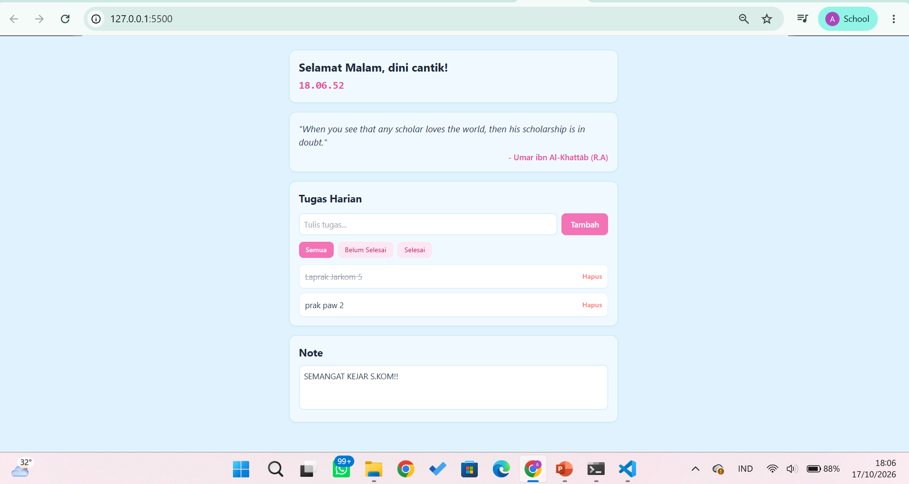
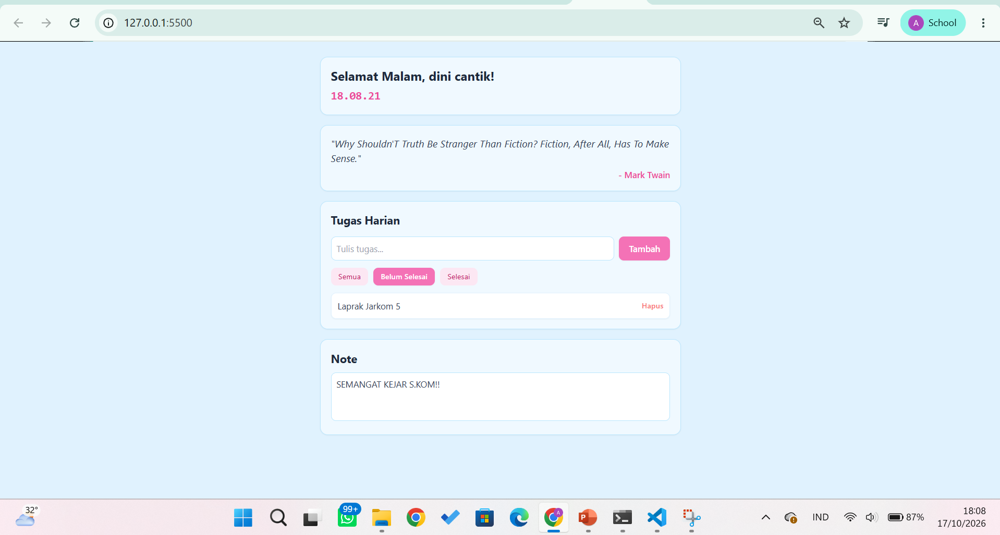
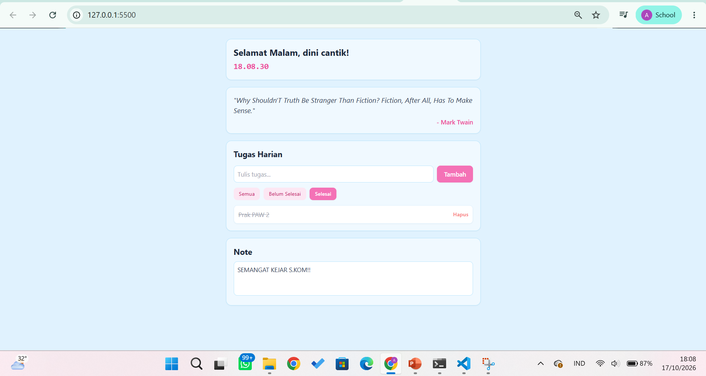
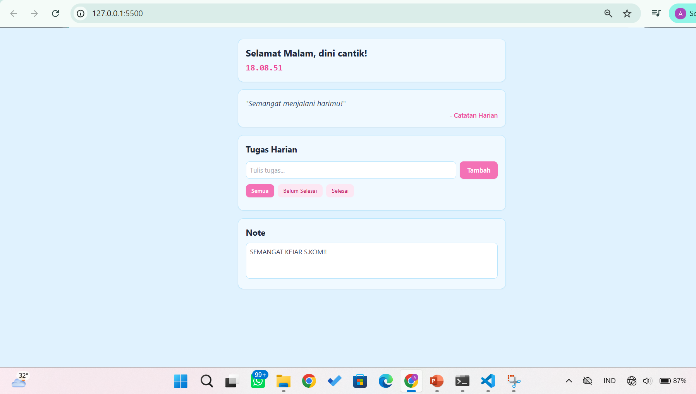

# Personal Dashboard - Praktikum PAW Pertemuan 2

## Identitas

- **Nama Lengkap :** _Andini_
- **NIM :** _124140192_
- **Kelas Praktikum :** _RB_

## Deskripsi Aplikasi

Aplikasi web **Personal Dashboard** sederhana berbasis JavaScript ES6+ dan Tailwind CSS dengan nuansa warna pastel (biru muda dan pink). Aplikasi ini membantu pengguna memantau waktu/salam secara dinamis, mendapatkan quote motivasi acak dari API eksternal, mengelola To-Do List (tugas harian) interaktif, serta menyimpan catatan cepat (Note).

Studi kasus yang dipilih: **Personal Dashboard (Tugas Harian & Catatan)**.

## Panduan Menjalankan

1. Clone / unduh repository ini.
2. Buka folder `Andini_124140192_pertemuan2` di VS Code.
3. Klik kanan `index.html` → **Open with Live Server** (atau cukup klik dua kali `index.html` untuk membukanya langsung di browser).

## Struktur Folder
```
Andini_124140192_pertemuan2/
├── index.html          # Struktur halaman utama
├── dashboard.js        # Logika aplikasi
├── README.md           # Dokumentasi proyek
│
├── modul/               # Latihan praktikum
│   ├── index.html
│   └── data.js
│
└── screenshot/          # Dokumentasi screenshot
    ├── belum.png
    ├── offline.png
    ├── semua.png
    └── selesai.png
```

## Daftar Fitur

- [x] Jam dinamis (*real-time*) & salam otomatis berbasis kondisi waktu
- [x] Fetch quote acak secara dinamis dari API eksternal (`dummyjson.com`)
- [x] Penanganan *error* / fallback quote lokal saat offline/jaringan mati
- [x] Input tugas baru untuk To-Do List
- [x] Indikator visual tombol filter aktif (Semua, Belum Selesai, Selesai)
- [x] Fitur saring/filter tugas berdasarkan status
- [x] Toggle status tugas (selesai / belum selesai) dengan efek coret teks
- [x] Hapus item tugas harian
- [x] Fitur Catatan Cepat (Note) dengan auto-save ke `localStorage`
- [x] Tampilan antarmuka berbasis Tailwind CSS dengan skema warna pastel

## Tangkapan Layar

| Tampilan / Kondisi | Gambar |
| ------------------ | ------ |
| Menampilkan Semua Tugas |  |
| Filter Tugas Belum Selesai |  |
| Filter Tugas Selesai |  |
| Fallback Quote saat Offline |  |

## Penjelasan Teknis Singkat

**Jam & Salam Dinamis.** Menggunakan *Arrow Function* `aturWaktu()` yang dipanggil setiap 1 detik via `setInterval()`. Kondisi `if-else` menentukan ucapan salam (*Selamat Pagi/Siang/Sore/Malam*) berdasarkan nilai `getHours()`, lalu ditampilkan bersama nama pengguna menggunakan *Template Literals*.

**Fetch Quote API.** Fungsi `async/await` digunakan untuk mengambil quote acak dari API `https://dummyjson.com/quotes/random`. Hasil respons di-destrukturisasi (`const { quote, author } = data`) lalu ditampilkan ke DOM. Blok `try...catch` menangani kondisi saat koneksi internet terputus dengan menampilkan pesan fallback offline.

**Manajemen To-Do List.** Menggunakan array `daftarTugas` dan *Array Methods* ES6+.
- Filter data menggunakan `.filter()` sesuai nilai `filterAktif` untuk menampilkan tugas yang sesuai.
- Render list menggunakan `.forEach()` untuk membuat elemen DOM secara dinamis.
- Penambahan tugas baru memanfaatkan *Spread Operator* (`[...daftarTugas, tugasBaru]`).
- Perubahan status toggle menggunakan `.map()`.

**Catatan Cepat (Note).** Teks pada elemen `<textarea>` disimpan secara otomatis ke `localStorage` melalui *event listener* `input` sehingga data catatan tidak hilang saat halaman di-refresh.