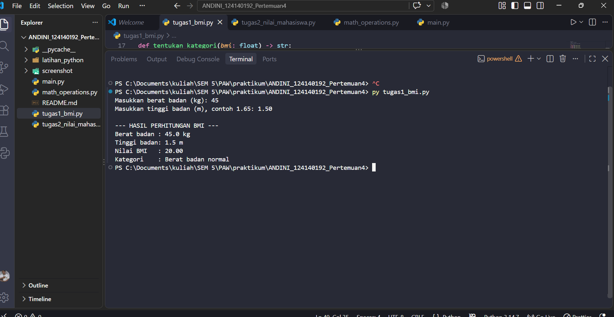
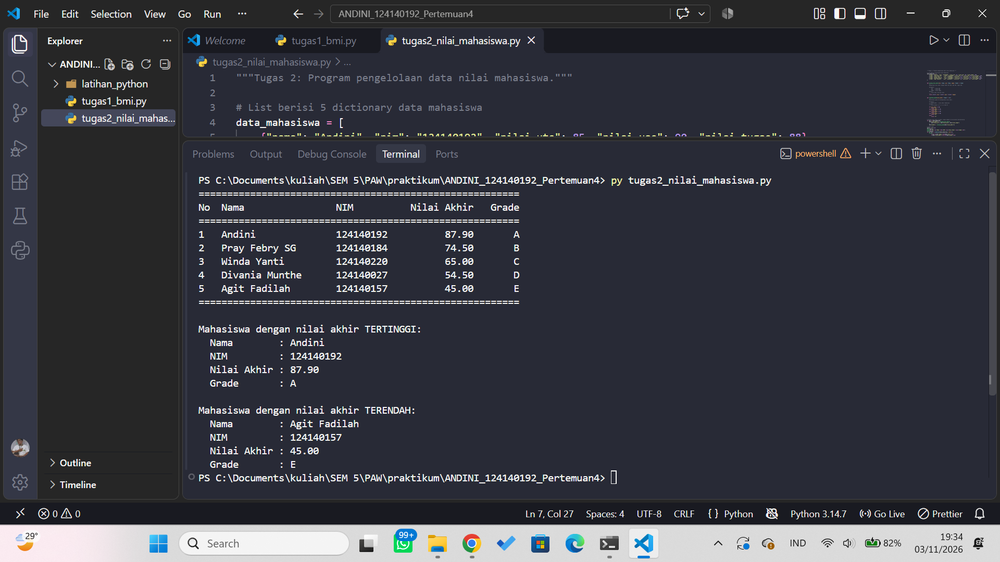
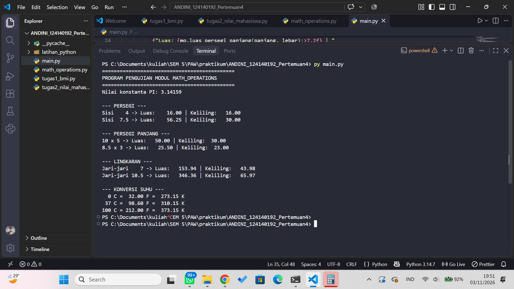

# Dasar Pemrograman Python - Praktikum PAW Pertemuan 4

## Identitas

- **Nama Lengkap :** _Andini_
- **NIM :** _124140192_
- **Kelas Praktikum :** _RB_

## Deskripsi Aplikasi

Kumpulan program **Python Dasar** yang mencakup variabel dan tipe data, struktur kendali (`if-elif-else` dan loop), fungsi, struktur data koleksi (list dan dictionary), serta pembuatan modul kustom. Repositori ini berisi tiga tugas utama, yaitu penghitung BMI, pengelolaan data nilai mahasiswa, dan modul matematika, ditambah praktik modul dan latihan mandiri.

Studi kasus yang dikerjakan:
1. **Program Penghitung BMI** (`tugas1_bmi.py`)
2. **Pengelolaan Data Nilai Mahasiswa** (`tugas2_nilai_mahasiswa.py`)
3. **Modul Matematika & Program Penggunaannya** (`math_operations.py` dan `main.py`)

## Panduan Menjalankan

1. Clone / unduh repository ini.
2. Pastikan Python 3 sudah terpasang (cek dengan `python --version` atau `py --version`).
3. Buka folder `ANDINI_124140192_Pertemuan4` di VS Code, lalu buka terminal (`` Ctrl + ` ``).
4. Jalankan program dengan perintah berikut:

```bash
python tugas1_bmi.py
python tugas2_nilai_mahasiswa.py
python main.py
```

> Pada Windows, jika perintah `python` tidak dikenali, gunakan `py` (contoh: `py tugas1_bmi.py`).

Untuk praktik modul dan latihan mandiri, masuk ke subfolder terlebih dahulu:

```bash
cd latihan_python
python 01_pengenalan.py
python 06_modul_app.py
```

## Struktur Folder
```
ANDINI_124140192_Pertemuan4/
├── .gitignore
├── README.md                    # Dokumentasi proyek
├── tugas1_bmi.py                # Soal 1: Penghitung BMI
├── tugas2_nilai_mahasiswa.py    # Soal 2: Pengelolaan nilai mahasiswa
├── math_operations.py           # Soal 3: Modul matematika
├── main.py                      # Soal 3: Program utama pemanggil modul
│
├── latihan_python/              # Praktik modul & latihan mandiri
│   ├── 01_pengenalan.py
│   ├── 02_variabel.py
│   ├── 03_kendali.py
│   ├── 04_fungsi.py
│   ├── 05_struktur_data.py
│   ├── kalkulator_lib.py
│   ├── 06_modul_app.py
│   ├── latihan1.py
│   ├── latihan2_suhu.py
│   ├── latihan3_tebak.py
│   ├── latihan4_validasi.py
│   ├── latihan5_kontak.py
│   ├── password_gen.py
│   └── main_password.py
│
└── screenshot/                  # Dokumentasi screenshot
    ├── soal1.png
    ├── soal2.png
    └── soal3.png
```

## Daftar Fitur

- [x] Input berat dan tinggi badan melalui `input()` pada program BMI
- [x] Perhitungan nilai BMI dengan format 2 angka desimal (f-string)
- [x] Penentuan 4 kategori BMI menggunakan struktur `if-elif-else`
- [x] List berisi 5 dictionary data mahasiswa (nama, nim, nilai_uts, nilai_uas, nilai_tugas)
- [x] Perhitungan nilai akhir berbobot (30% UTS + 40% UAS + 30% Tugas)
- [x] Penentuan grade A sampai E berdasarkan nilai akhir
- [x] Tampilan tabel rapi di terminal dengan perataan f-string
- [x] Pencarian mahasiswa dengan nilai akhir tertinggi dan terendah
- [x] Modul `math_operations` berisi luas dan keliling (persegi, persegi panjang, lingkaran)
- [x] Fungsi konversi suhu (Celsius ke Fahrenheit dan Celsius ke Kelvin)
- [x] Konstanta `PI` pada modul matematika
- [x] Penerapan lebih dari 2 cara import (`import`, `from ... import`, dan alias `as`)
- [x] Docstring pada setiap fungsi dan penulisan kode mengikuti PEP 8

## Tangkapan Layar

| Tampilan / Kondisi | Gambar |
| ------------------ | ------ |
| Soal 1: Hasil Program Penghitung BMI |  |
| Soal 2: Tabel Nilai Mahasiswa, Tertinggi & Terendah |  |
| Soal 3: Hasil Pemanggilan Modul `math_operations` |  |

## Penjelasan Teknis Singkat

**Soal 1 - Penghitung BMI.** Program meminta berat badan (kg) dan tinggi badan (m) melalui `input()` yang dikonversi dengan `float()`. Fungsi `hitung_bmi()` menghitung nilai BMI dengan rumus `berat / (tinggi * tinggi)`, kemudian fungsi `tentukan_kategori()` menentukan kategori menggunakan struktur `if-elif-else`:
- `BMI < 18.5`: Berat badan kurang
- `18.5 ≤ BMI < 25`: Berat badan normal
- `25 ≤ BMI < 30`: Berat badan berlebih
- `BMI ≥ 30`: Obesitas

Hasil ditampilkan dengan f-string dan format `:.2f` agar BMI tampil 2 angka desimal.

**Soal 2 - Pengelolaan Data Nilai Mahasiswa.** Data disimpan dalam list `data_mahasiswa` yang berisi 5 dictionary.
- Nilai akhir dihitung oleh `hitung_nilai_akhir()` dengan bobot 30% UTS, 40% UAS, dan 30% Tugas.
- Grade ditentukan oleh `tentukan_grade()` (A ≥ 80, B ≥ 70, C ≥ 60, D ≥ 50, selain itu E).
- Hasil perhitungan disimpan kembali ke dictionary masing-masing mahasiswa.
- Tabel dicetak dengan perataan f-string (`:<` rata kiri, `:>` rata kanan). Lebar kolom nama dihitung otomatis dari nama terpanjang menggunakan `max(len(...))` agar tabel tetap rapi.
- Mahasiswa dengan nilai tertinggi dan terendah dicari dengan `max()` dan `min()` yang dipadukan dengan fungsi `lambda` sebagai `key`.

**Soal 3 - Modul Matematika.** Berkas `math_operations.py` berisi konstanta `PI = 3.14159`, enam fungsi geometri (luas dan keliling untuk persegi, persegi panjang, dan lingkaran), serta dua fungsi konversi suhu (`celsius_ke_fahrenheit` dan `celsius_ke_kelvin`). Setiap fungsi dilengkapi docstring. Berkas `main.py` memanfaatkan seluruh fungsi tersebut dengan tiga cara import:
- `import math_operations` (dipanggil dengan awalan nama modul)
- `from math_operations import celsius_ke_fahrenheit, celsius_ke_kelvin, PI` (dipanggil langsung)
- `import math_operations as mo` (dipanggil lewat alias)

Blok `if __name__ == "__main__":` pada modul mencegah kode uji coba ikut berjalan saat modul di-import.

**Praktik Modul & Latihan Mandiri.** Folder `latihan_python/` berisi kode praktik dari modul (`01_pengenalan.py` sampai `06_modul_app.py` beserta `kalkulator_lib.py`) serta latihan mandiri: kartu identitas berbingkai `#`, konversi suhu, game tebak angka, validator password, katalog kontak, dan generator password acak.